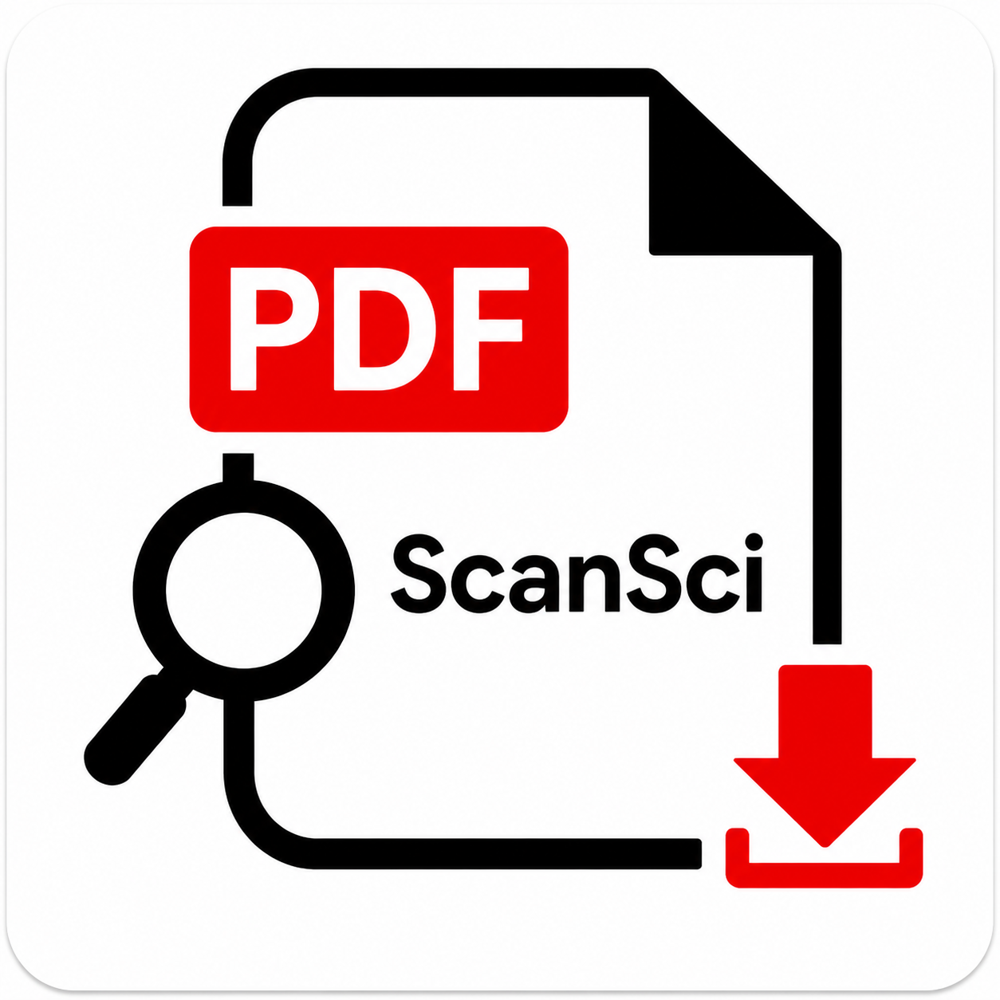

<div align="center">
  
  <h1>ScanSci PDF</h1>

  <a href="https://pypi.org/project/scansci-pdf/"></a>
  <a href="./LICENSE"></a>

  不用懂代码，也不用记命令。把论文题目、链接或清单交给 Agent，它帮你找、帮你下、帮你整理。
</div>

<p align="center">
  <a href="#这是什么">这是什么</a> ·
  <a href="#能做什么">能做什么</a> ·
  <a href="#开始使用">开始使用</a> ·
  <a href="#你会得到什么">你会得到什么</a> ·
  <a href="#使用边界">使用边界</a> ·
  <a href="#进阶参考">进阶参考</a>
</p>

## 这是什么

**ScanSci PDF 是面向 AI Agent 的学术文献获取与发现工具。**给它 DOI、arXiv ID、文章链接、文献清单，或一个研究问题；它会按当前配置查找候选来源，并尝试获取可访问的文献，把结果整理为 PDF、引用和附件。

它提供 Agent Skill / 插件、MCP Server 和 CLI 三种入口。你可以直接用自然语言提出任务，也可以把命令接入脚本或批处理流程。

> 不知道 DOI 也没关系，直接发论文标题或链接即可。

### 适合谁

- 需要获取单篇论文或处理整份文献清单的学生、研究者和实验室。
- 希望把论文检索、下载和归档接入 AI Agent 工作流的人。
- 需要机构通道、中文文献、引用导出或综述证据整理的人。

如果你只需要 PDF 阅读器、文献管理器或扫描件 OCR，请选择对应的专用工具；ScanSci PDF 不内置 OCR。

## 能做什么

| 任务 | 输入示例 | 结果 |
|---|---|---|
| **单篇获取** | DOI、arXiv ID 或文章 URL | 按“作者_年份_标题”命名的论文文件，并可导出引用。 |
| **批量处理** | xlsx、csv、bib、APA、txt 等清单 | 去重、补全元数据、分批处理，并生成成功 / 失败结果清单。 |
| **检索与发现** | 关键词、作者或研究问题 | 合并 OpenAlex、Crossref、Semantic Scholar、NCPSSD 等结果；可先准备队列再确认。 |
| **机构与中文来源** | 学校权限或中文论文信息 | 可用通道包括 WebVPN、CARSI、EZProxy、期刊官网、知网、万方、维普等。 |
| **整理与取证** | 引用、附件或原文证据需求 | BibTeX / RIS / EndNote、补充材料、Markdown；Sciverse 语义证据为可选能力。 |

批量任务可以先分类哪些能直接获取、哪些需要机构权限。下载失败时会返回渠道失败原因和下一步建议。

## 开始使用

### Agent 插件

将下面这句话发给 Codex、Claude Code、Cursor、Qoder 或 ZCode 等 Agent：

```text
帮我安装或更新这个插件：https://github.com/Rimagination/scansci-pdf
```

DeepSeek Harness 可从插件管理界面安装 `scansci-pdf`。安装完成后，先检查本机环境：

```bash
scansci-pdf check
```

然后直接描述任务，例如：

```text
帮我下载这篇 DOI 对应的论文，并把 BibTeX 一起导出。
```

### CLI / MCP

需要 Python 3.11 或更新版本。基础安装和单篇下载示例：

```bash
python -m pip install scansci-pdf
scansci-pdf check
scansci-pdf get 10.1038/nature12373
```

也可以通过标准 MCP 配置接入支持 MCP 的客户端。WebVPN、浏览器后端等按使用场景安装可选依赖，见[完整技术参考](docs/REFERENCE.md)。

## 你会得到什么

- **PDF：**默认按“作者_年份_标题”整理。
- **引用：**BibTeX、RIS、EndNote；可推送 Zotero。
- **附件：**需要时获取论文补充材料。
- **批量结果：**成功 / 失败清单及来源诊断信息。
- **可选 Markdown：**将有文本层的 PDF 转成便于阅读和检索的文本。

## 使用边界

- 付费墙全文需要你自己的学校账号、机构网络或其他授权；没有合法开放副本时，工具无法凭空获取。
- 默认配置可能包含灰色来源候选；来源是否可用还受宿主策略和本机配置影响。请确认目标文献的访问授权。
- 只使用合法开放和机构来源时，可明确要求“只用合法来源”，或运行 `scansci-pdf config-cmd download_strategy legal_only`。
- 扫描版 PDF 可能没有文本层；本工具不负责 OCR。
- 没有明确下载请求时，不会自动批量下载；检索结果可先确认再保存。

## 进阶参考

- [完整技术参考](docs/REFERENCE.md)：客户端配置、数据源、机构通道与排障。
- [反爬与镜像维护手册](docs/PLAYBOOK.md)：维护者与高级用户参考。
- [Issues](https://github.com/Rimagination/scansci-pdf/issues)：报告问题或提出需求。
- 许可证：[MIT](LICENSE)。
