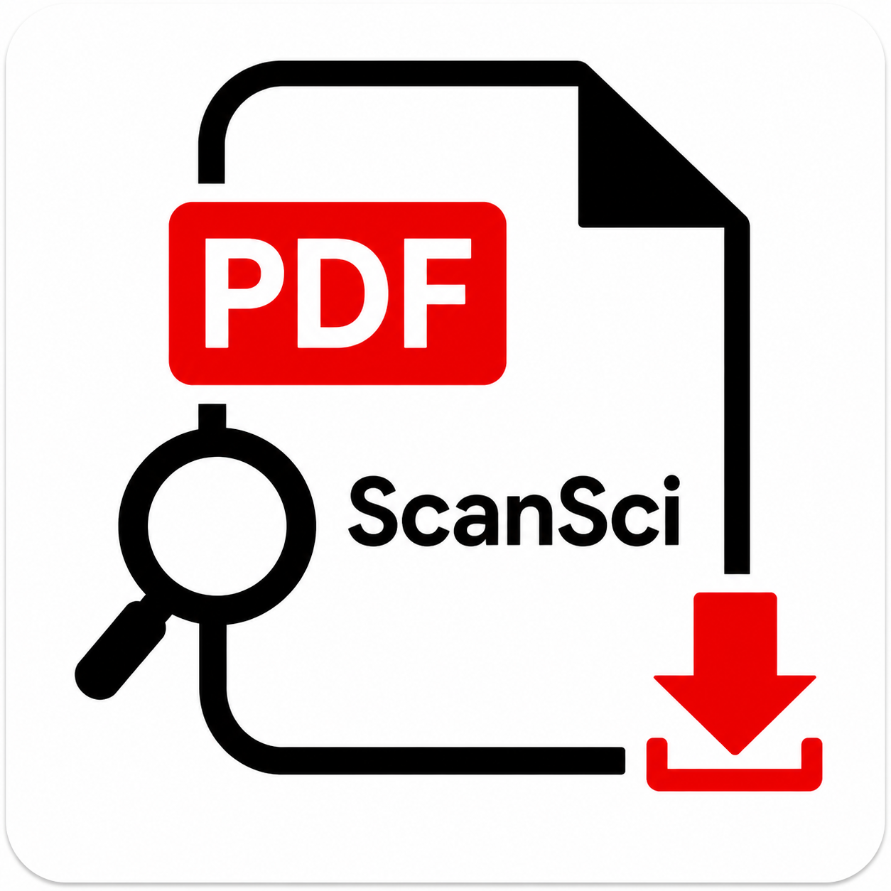

<div align="center">
  
  <h1>ScanSci PDF</h1>

  <a href="https://pypi.org/project/scansci-pdf/"></a>
  <a href="../LICENSE"></a>
  <a href="https://modelcontextprotocol.io"></a>

  让 Agent 替你下载学术论文 —— 20+ 数据源并行竞速，100+ 高校机构通道，一句自然语言拿下整份文献清单。

  [这是什么](#这是什么) · [客户端兼容性](#客户端兼容性) · [浏览器](#浏览器成功率的最大单一变量) · [快速开始](#快速开始) · [使用案例](#使用案例) · [检索与发现](#检索与发现) · [机构通道](#机构通道) · [参考](#参考) · [故障排查](#故障排查) · [使用边界](#使用边界与合规) · [社区](#交流群--community)
</div>

## 这是什么

ScanSci PDF 是一个面向 AI Agent 的学术文献获取与发现工具。它同时提供 **MCP Server、CLI 和 Agent Skill/插件** 三种入口：你给它 DOI、arXiv ID、文章 URL、文献清单或一句研究问题，它会自动选择最快能拿到全文的路径，并把结果整理成可归档的 PDF 和引用。

它解决的是“从‘我知道要哪篇/哪个主题’到‘文件已经在本地且命名规整’”这一段：免费副本、出版商 API、学校权限、中文数据库、灰色源（按配置）会并行尝试，失败时逐级溢流，而不是让你在十几个网站之间手动切换。

### 适合谁

- 需要**单篇或批量下载**论文的研究者、学生、实验室和科研团队。
- 已经在使用 Claude、Cursor、ZCode、Codex 等 Agent，希望把文献获取变成一句话的人。
- 需要**机构权限、中文文献、综述证据检索、引文导出**的人。
- 想把下载结果整理成 PDF + 引用 + 附件 + Markdown 的人。

### 不适合谁

- 只需要 PDF 阅读器或文献管理器（请用 Zotero、ReadPaper 等专门工具）。
- 需要 OCR 扫描版 PDF 全文识别的人（本工具不内置 OCR）。
- 没有合法访问权限、且不愿意自行确认授权与合规性的人。

### 你需要准备

- **Python 3.11+**（`pip install scansci-pdf` 或从源码安装）。
- 一个 **DOI / arXiv ID / 文章 URL / 文献清单**（xlsx、csv、bib、APA、txt 均可）。
- 付费墙论文需要你的**学校账号或机构网络**（WebVPN / CARSI / EZProxy / 出版商 SSO）。
- 可选：Elsevier、Springer、Sciverse 的 API Key（更快/更强，不配也能用）。

### 三步工作流

```text
给 DOI / arXiv / URL / 清单 / 研究问题
              ↓
自动选路：OA 副本 → 出版商 API → 机构通道 → 中文库（灰色源按配置）
              ↓
得到：规整命名的 PDF + 引用/附件/Markdown + 明确的失败原因
```

## 客户端兼容性

同一份 MCP 配置，在不同宿主里能走多远并不一样。差别来自**宿主平台自身的策略与沙箱**，不是插件配置——仓库里没有任何按宿主分支的代码，`.mcp.json` 对所有宿主都是同一份。

<details>
<summary><strong>宿主差异与策略对齐</strong></summary>

| 宿主 | 灰色源（Sci-Hub / LibGen） | 说明 |
|---|---|---|
| ZCode、Claude Code | 可用 | 灰源正常参与竞速；`fastest`（默认）下自动作为付费墙兜底 |
| DeepSeek Harness（DSH） | 可用 | 通过 `dsh-plugin/` bundle 以 stdio 接入同一 MCP server；宿主策略与原 MCP 客户端一致 |
| Codex、workbuddy | 被平台拦截 | 宿主策略限制该类请求；OA 与机构通道不受影响，付费墙论文仍可走学校订阅 |
| 其他标准 MCP 客户端 | 取决于客户端 | 工具本身不做宿主判断，只看客户端是否允许该类请求 |

在受限宿主里，如果想显式对齐策略、不再尝试灰源，把下载策略固定成 `legal_only`：

```bash
scansci-pdf config-cmd download_strategy legal_only
```

在允许灰源的宿主里不需要任何设置。想反过来只走灰源，用 `scihub_only`；只走灰源竞速但不要 OA，用 `grey_only`。

</details>

## 浏览器：成功率的最大单一变量

同一篇论文、同一台机器，换个浏览器内核，能不能下下来可以完全不同。很多人不在意自己跑的是哪个浏览器，但**成功率差别很大**。

<details>
<summary><strong>四条原因与建议设置</strong></summary>

- **登录态只来自工具打开的那个浏览器。** `scansci_pdf_login` 会打开工具自带的可见浏览器，cookie 是从**那个上下文**抓取并落盘的。用你的日常 Chrome / Safari / Edge 登录、或让窗口无头运行，都拿不到会话——症状是"我明明登录成功了"，下载却仍然失败。
- **Cloudflare / CAPTCHA 能不能过，取决于内核。** 内核过旧或指纹不对，验证页直接把请求挡掉。`patchright` 1.56–1.61 有一个 Turnstile 组件空白页的已知 bug，表现就是"验证框根本没出现"。
- **出版商看 TLS / HTTP 指纹。** 同样的 cookie，Python HTTP 客户端可能 403，而真实浏览器能过——所以机构通道的最后一公里常常只能交给浏览器去取字节。
- **浏览器看到的出口 IP，就是出版商看到的 IP。** 一旦开了系统/全局代理，出口变成代理机房，机构 IP 授权当场失效（见下方 Elsevier 一节的 CPE 说明）。

**建议设置。** 代码默认是 `patchright`，而它恰好在 Turnstile 上有上面那个 bug，所以值得显式改掉：

| 配置项 | 建议 | 说明 |
|---|---|---|
| `browser_backend` | `cloakbrowser` 或 `camoufox` | 回退顺序为 `patchright → cloakbrowser → camoufox`；cloakbrowser 低于 0.5.9 会被**硬拒绝**（内核过旧会被出版商标记并拒绝服务），camoufox 是反指纹 Firefox 内核 |
| `browser_headless` | `false` | 机构登录 / CAPTCHA / Cloudflare 都需要可见窗口 |
| `browser_executable` | 你装的 Chrome 路径 | **坚持用自己的浏览器就用这一条**：让工具拿你装的 Chrome 当内核，而不是把登录态留在工具外面 |

```bash
scansci-pdf config-cmd browser_backend cloakbrowser
scansci-pdf config-cmd browser_headless false
```

另外两条兜底：把内核指向你自己的 Chrome（`config-cmd browser_executable "C:\Program Files\Google\Chrome\Application\chrome.exe"`），或直接导入 cookie（`scansci_pdf_login(kind="cookie_import", cookie_file="cookies.txt")`；CARSI 还会自动读取本机 Chrome 的 cookie 库）。用 `scansci-pdf browser-status` 可查看当前实际生效的内核。

</details>

## 快速开始

安装和更新是同一句话——对 Codex、ZCode、Claude Code 都这么说：

```text
帮我安装或更新这个插件：https://github.com/Rimagination/scansci-pdf
```

Agent 会克隆（或原地更新）仓库、装好依赖并注册插件，然后你就能直接让它下论文了——例子见下一节[使用案例](#使用案例)。装好后建议先跑一次：

```bash
scansci-pdf check
```

它会检查依赖、浏览器、Tor 和 API Key 配置，并提示还能补什么。

### DeepSeek Harness（DSH）

DSH 可以直接从插件管理界面安装，不需要手动配 MCP：

1. 侧边栏 **Plugins** → **Add plugin**
2. 输入 npm 包名 **`scansci-pdf`**（与 PyPI 包同名）
3. 安装源保持默认，或按网络情况选 **中国大陆镜像源**
4. 点击 **Install**，确认插件列表中 bundle 为 **On**

安装后会自动注册 stdio MCP server 和 `scansci-pdf` / `scansci-sort` 两个 skill，通常无需重启。开发本地版本时，也可以把本仓库 `dsh-plugin/` 的**绝对路径**填进 Add plugin，或直接对 agent 说“安装这个 DSH bundle：`<仓库路径>/dsh-plugin`”。详见 [`dsh-plugin/README.md`](../dsh-plugin/README.md)。

<details>
<summary><strong>手动安装 / pip / MCP 配置</strong>（不走对话流程时）</summary>

```bash
pip install scansci-pdf
```

> **基础安装只含 HTTP 通道。** 浏览器后端与 WebVPN 的加密依赖都是**可选 extra**，不装的话 OA 与出版商 API 车道照常工作，但**机构登录（WebVPN / CARSI / EZProxy）和隐身浏览器通道会失败**。按你的场景补装：

| 想做什么 | 装什么 |
|---|---|
| WebVPN / 校园连接器 | `pip install "scansci-pdf[vpnsci]"`（提供 `pycryptodome`，WebVPN 的 URL 加密必需） |
| 浏览器登录、CARSI、绕过 Cloudflare | `pip install "scansci-pdf[cloakbrowser]"`（隐身 Chromium 内核） |
| 一组装齐（推荐） | `pip install "scansci-pdf[cloakbrowser,vpnsci]"` |
| 换用 Camoufox / Patchright 内核 | `pip install "scansci-pdf[camoufox]"` 或 `pip install "scansci-pdf[patchright]"` |

标准 MCP 配置（Claude Desktop / Cursor / Windsurf / Cline / Cherry Studio…）：

```json
{
  "mcpServers": {
    "scansci-pdf": {
      "command": "scansci-pdf",
      "args": ["run"]
    }
  }
}
```

Codex App / Codex CLI（Windows 一键：克隆 + 装环境 + 注册插件）：

```powershell
powershell -NoProfile -ExecutionPolicy Bypass -Command '$p=Join-Path $HOME "plugins\scansci-pdf"; if(Test-Path $p){ git -C $p pull --ff-only } else { git clone --branch main --single-branch https://github.com/Rimagination/scansci-pdf.git $p }; & (Join-Path $p "scripts\install-scansci-pdf.ps1")'
```

ZCode：插件市场搜 `scansci-pdf` 一键安装，MCP、skills、快捷命令一次带齐。

**插件入口**：Codex = `.codex-plugin/plugin.json` + `.mcp.json`（自动注册 MCP server）+ `skills/`；ZCode = [`zcode-plugin/`](../zcode-plugin/)（marketplace 包：skills + `/scansci` 快捷命令）；Claude Code = `.claude/skills/` + 上面的标准 MCP 配置；DeepSeek Harness = npm 包 `scansci-pdf` 或 [`dsh-plugin/`](../dsh-plugin/)（bundle：MCP client + skills + locale/icon）。

手动安装（Codex）：仓库放到 `%USERPROFILE%\plugins\scansci-pdf` → `python -m pip install -e .` → 插件管理页刷新个人 marketplace；Codex CLI 可用时执行 `codex plugin add scansci-pdf@local-plugins`。

</details>

<details>
<summary><strong>其他部署方式</strong>（HTTP 远程 / Docker）</summary>

HTTP 模式（远程部署或不支持 stdio 的场景，默认只监听本机）：

```bash
scansci-pdf run --mode streamable_http --host 127.0.0.1 --port 8000
```

Docker（内置 MCP 服务器 + Tor，数据卷持久化）：

```bash
docker compose up -d
```

</details>

## 使用案例

你只需要说一句话，剩下的交给它。下面是最常见的场景：

| 场景 | 你可以这样说 | 它做什么 / 你得到什么 |
|---|---|---|
| **单篇** | “帮我下 10.1038/nature12373 这篇论文” | 自动选 OA/出版商/机构路径；得到 `作者_年份_标题.pdf` |
| **整批清单** | “这个 3000 篇的 xlsx，先分类哪些能直接下、哪些要机构权限，再分批下载” | 去重、补 DOI、分车道调度；得到 PDF + `download_results.json` |
| **主题检索 + 下载** | “搜 2023 年以来‘城市热岛’被引最高的 10 篇，然后下载” | OpenAlex/Crossref/S2/NCPSSD 合并；可先生成队列再下载 |
| **学校权限** | “用北大 WebVPN 下这篇 Elsevier” | 走 WebVPN/CARSI/出版商 SSO；登录在你自己的浏览器完成 |
| **中文文献** | “下这篇 10.3969/j.issn.1674-4993.2024.02.008” | 自动切 NCPSSD/期刊官网/知网/万方/维普；CAJ 保留原扩展名 |
| **综述取证** | “找几段讨论石墨烯衰减机制的原文，要页码” | Sciverse 返回带 `doc_id`/页码/offset 的证据片段 |
| **失败诊断** | “这篇下不下来，帮我看看卡在哪” | 返回每个渠道的失败原因和下一步动作 |
| **引用整理** | “把这批论文的 BibTeX 导出来，推到 Zotero” | BibTeX/RIS/EndNote 导出 + Zotero 推送 |

> 没有说“下载”的请求，它不会自动批量下载；检索结果需要你确认后再落盘。

### 命令行等价

| 场景 | 命令 |
|---|---|
| 单篇 | `scansci-pdf get 10.1038/nature12373` |
| 批量 | `scansci-pdf batch 文献清单.xlsx --lanes` |
| 检索成队列 | `scansci-pdf search "carbon cycle" --out q.txt` |
| 体检 | `scansci-pdf check` |

### 两种入口

| 入口 | 适合 | 怎么开始 |
|---|---|---|
| **Agent / MCP** | 日常对话、让 Agent 自动选路和排障 | 安装插件或配置 MCP，直接说“帮我下这篇…” |
| **CLI** | 脚本、批处理、CI、精细控制 | `pip install scansci-pdf`，用 `get` / `batch` / `search` |

### 你会得到什么

- 默认交付 **PDF**，自动按 `作者_年份_标题.pdf` 命名。
- `--si`：补充材料/附件。
- `--md`：PDF 转成 Agent 友好的 Markdown（PDF 仍是默认交付物）。
- **BibTeX / RIS / EndNote** 引文，可推送 **Zotero**。
- 批量结果写入 `download_results.json`；下载缓存用 `.doi_index.json` 记录来源与 TTL。
- 下载失败时返回 `error_type`、`action`、`source_failures`（每个渠道为什么失败）和 `agent_hint`，不会静默换渠道。

## 能力

| 能力 | 说明 |
|---|---|
| 单篇 / 批量 | DOI / arXiv / URL / 清单 → 自动选路 → 规整命名 PDF；BibTeX / RIS / EndNote / Zotero |
| 检索与发现 | OpenAlex / Crossref / S2 / NCPSSD + 引文追踪 + 检索协议 + 队列准备 |
| 机构与中文 | Elsevier API、100+ 高校 WebVPN、CARSI、EZProxy；NCPSSD / 知网 / 万方 / 维普 |
| 语义证据（可选） | Sciverse 正文片段、元数据、引文图谱、图表下载 |
| 整理输出 | SI 附件、Markdown、引用导出、批量结果 JSON |
| 稳定性 | 反爬、会话自愈、封 IP 停损、负缓存、断点续传、20 个 MCP 工具 |

## 检索与发现

内置检索会把 OpenAlex、Crossref、Semantic Scholar、NCPSSD（中文）的结果合并去重；如果安装了可选的 `scansci-find` CLI，还会接入它的 13 源发现引擎。配置 Sciverse 后，语义证据片段和结构化元数据也会自动并入。

```bash
# 关键词检索，结果落成下载队列
scansci-pdf search "carbon cycle" --limit 10 --out q.txt

# 作者检索
scansci-pdf search --author "Fang Jingyun" --limit 10 --sort cited_by_count

# 前向/后向引文追踪（MCP）
# scansci_pdf_expand_citations(query="...", rounds=2)
```

MCP 侧对应：

- `scansci_pdf_search` — 关键词/作者检索，可写队列文件。
- `scansci_pdf_find` — ScanSci Find 系统综述协议：plan / estimate / smoke / calibrate。
- `scansci_pdf_expand_citations` — Semantic Scholar / OpenCitations 引文追踪。
- `scansci_pdf_prepare_queue` — 校验 DOI、解析 OA 位置、构建下载队列。
- `scansci_pdf_parse_list` — 解析 APA / BibTeX / DOI 列表 / TSV / csv / xlsx。

### Sciverse（可选，语义检索与元数据）

[Sciverse](https://sciverse.space) 提供互补的两层能力：`agentic-search` 把自然语言研究问题转成**可引用的证据片段**（带 `doc_id` / `chunk_id` / `offset` / 页码），`meta-search` 按字段精确检索元数据（带 DOI、`unique_id`）。**不配置不影响现有检索与下载。**

配置一次即可：

1. 打开 [Sciverse 控制台](https://sciverse.space/tokens) 创建 API Token。
2. 配置并当场验证：

```bash
scansci-pdf sciverse-setup --token YOUR_TOKEN --test
```

MCP 等价写法：`scansci_pdf_sciverse_setup(token="YOUR_TOKEN", test=true)`（未配置时会打开控制台并给出注册指引）。

3. 之后 `scansci-pdf search` 自动并入 Sciverse；配额紧张时执行 `scansci-pdf config-cmd sciverse_meta_search_enabled false` 只保留语义路。

<details>
<summary><strong>Sciverse 能力表、场景行为与命令</strong></summary>

| 能力 | MCP `scansci_pdf_sciverse` | CLI | 用途 |
|---|---|---|---|
| 语义证据 | `action="search"` | `sciverse-search` | 自然语言 → 正文证据片段，适合综述取证 |
| 读全文 | `action="content"` | `sciverse-content` | 按 `doc_id` 读全文，`offset`/`limit` 分页 |
| 元数据检索 | `action="meta_search"` | `sciverse-meta-search` | 按年份/期刊/作者/DOI/引用数筛选，返回 DOI/`unique_id` |
| 引文图谱 | `action="relations"` | `sciverse-relations` | 按 `unique_id` 分页拉取被引/参考文献/相关工作 |
| 字段目录 | `action="catalog"` | `sciverse-catalog` | 查看 meta-search 可用字段、算子与样例值 |
| 图表附件 | `action="resource"` | `sciverse-resource` | 下载正文里的图/表/附件二进制 |

- **自动合并**：`scansci-pdf search` 会把 agentic-search 的语义片段和 meta-search 的元数据一起并入 OpenAlex/Crossref/S2/NCPSSD 结果（按 `doc_id`/DOI/标题去重）。语义命中带 `evidence`，meta 命中补 `doi`/`unique_id`。
- **场景化补 DOI**：统一 `search` 会自动补 DOI（多 1 次 doc_id 定向 meta-search）；单独的 `sciverse-search` 默认不补，适合纯证据检索。需要下载时加 `--enrich-dois`（MCP `enrich_dois=true`）。
- **REFERENCES 标题限制**：`REFERENCES` 可能只返回 OpenAlex ID、`title` 为空；实测这些 ID 在 OpenAlex 里不可解析，客户端无法可靠补标题，保留 ID 供调用方处理。
- **总数上限**：`meta-search` 的 `total_count` 到 10000 就是上限，此时返回 `total_count_capped: true`，不要当精确总数。
- **高级过滤**：agentic 用 `filters_json`（对象，字段间 AND、同字段列表内 OR）；meta-search 用 `filters_json`（`{field, operator, value}` 数组，算子 `FILTER_OP_EQ/GTE/IN/MATCH_PHRASE/...`）+ `sort_json` + `fields`。
- `paper-schema BETA` 是独立的 18 个子操作结构化阅读 API（Entity/Relation/Evidence/引用图谱），目前未接入。

```bash
scansci-pdf sciverse-search "graphene battery cycle stability" --top-k 10 --year-from 2020
scansci-pdf sciverse-search "graphene battery cycle stability" --top-k 10 --enrich-dois
scansci-pdf sciverse-meta-search "graphene" --year-from 2020 --sort citation_count:desc --page-size 20
scansci-pdf sciverse-relations paper:10.1038/s41586-021-03819-2 --relation CITATIONS
scansci-pdf sciverse-content <doc_id> --offset 0 --limit 700
scansci-pdf sciverse-resource "dt=xxx/p_yyy/f3.png" --output-dir ./figures
scansci-pdf sciverse-catalog --samples
```

</details>

## 机构通道

付费墙论文优先走以下机构通道。登录都在你自己的浏览器里完成，密码不经过本工具。

### Elsevier API（推荐，无需浏览器）

ScienceDirect / Cell Press 等 Elsevier 论文走 API 直接下载，速度从 15–30 秒降到 1–2 秒。Key 申请免费、个人邮箱即可：

1. 访问 [Elsevier Developer Portal](https://dev.elsevier.com/) 创建应用，勾选 **ScienceDirect Article Retrieval**
2. 配置 Key：`scansci_pdf_elsevier_setup`（MCP 会打开浏览器引导）或 `scansci_pdf_config(key="elsevier_api_key", value="...")`

CLI 等价：

```bash
scansci-pdf elsevier-setup --api-key YOUR_KEY
scansci-pdf elsevier-check --doi 10.1016/j.example
```

> **权益跟随出口 IP**：API key 的机构身份靠 key + 请求源 IP 一起判定。离校使用要经 `network_proxy` / `SCANSCI_PDF_PROXY` 走校园出口；回 403 `Requestor configuration settings insufficient` 或网页带 `CPE` 码，先核对出口 IP 是否在机构网段，不要直接归因于“学校没订阅”。工具忽略 `HTTP_PROXY` / `HTTPS_PROXY`。

<details>
<summary><strong>Springer TDM（无需浏览器）</strong></summary>

`10.1007` 的 Springer 论文走 Full Text API，交付 **JATS XML 全文**（非 PDF，同名 `.xml` 落在 PDF 目录旁）：

1. 到 [dev.springernature.com](https://dev.springernature.com/) 免费注册，用 ORCID 关联机构
2. 配置 `scansci_pdf_springer_setup` 或 `scansci_pdf_config(key="springer_api_key", value="...")`

`scansci_pdf_springer_setup(test=true)` 会探测机构订阅与 TDM 权限：`entitled` / `not_entitled` / `invalid_key`；无权限时该车道自动让位给其他源。

</details>

<details>
<summary><strong>WebVPN（高校代理）</strong></summary>

```text
1. scansci_pdf_schools(action="search", query="北京")  → 搜你的学校
2. scansci_pdf_schools(action="set", school="你的学校")
3. scansci_pdf_login(kind="webvpn")                    → 浏览器完成 CAS 认证
4. scansci_pdf_channel_status(kind="webvpn_test")      → 确认连接正常
```

支持 100+ 所中国高校，命令行等价：`scansci-pdf schools 北京` / `scansci-pdf setup 北京航空航天大学`。

</details>

<details>
<summary><strong>CARSI（出版商联邦认证）</strong></summary>

```text
1. scansci_pdf_config(key="carsi_enabled", value="true")
2. scansci_pdf_config(key="carsi_idp_name", value="你的学校名称")
3. scansci_pdf_login(kind="carsi", publisher="sciencedirect")
```

支持 sciencedirect、springer、wiley、ieee、tandfonline、nature 等，以及中文库 CNKI、万方、维普。SAGE 中国站首次使用
`scansci_pdf_login(kind="carsi", publisher="sage-cn")` 登录；之后下载会复用已保存会话，
从文章页解析实际 `articleId` 并请求站点自身的 PDF 下载接口，无需反复开启浏览器。

</details>

<details>
<summary><strong>中文文献（NCPSSD / 知网 / 万方 / 维普）</strong></summary>

中文 DOI（`10.3969/...`、`10.16235/j.cnki...` 等）不走 Crossref，ScanSci PDF 会自动切换到中文通道，按顺序尝试：

1. **NCPSSD 国家哲学社会科学文献中心** — 人文社科合法免费全文，命中后直接下载，无需登录。
2. **中文期刊官网直链** — DOI 落到刊社网站（Magtech / `downloadArticleFile.do?attachType=PDF` 等）时，抓取官网免费 PDF。
3. **万方 / 知网 / 维普** — 校园网出口按 IP 授权；校外则用 CARSI 机构订阅。

```text
# 校园网用户：连上学校网络/VPN 即可，万方、维普通常自动按 IP 授权
scansci_pdf_download(identifier="10.3969/j.issn.1674-4993.2024.02.008")

# 校外 CARSI：先配置机构，再登录对应中文库（首次会打开浏览器选学校）
scansci_pdf_config(key="carsi_enabled", value="true")
scansci_pdf_config(key="carsi_idp_name", value="你的学校名称")
scansci_pdf_login(kind="carsi", publisher="cnki")     # 或 wanfang / cqvip
```

- **中文 DOI 归一化**：全角数字/斜杠、`doi：` 前缀、结尾中文标点（`。，；`）都会自动清洗；`10.3969` 识别为 China DOI/万方族，`/j.cnki` 识别为知网族。
- **CNKI / 万方双 ID 映射**：知网 DOI 经 `chndoi.org` 解析后可直接拿到 `filename` / `dbcode` / `tablename`；万方详情接口会返回内部 `file_id` 与 NCPSSD 记录号，便于跨库定位。
- **CAJ 格式**：知网部分论文只提供 `.caj`。下载器会保留 `.caj` 扩展名（不会伪装成 `.pdf`），并返回 CAJViewer / `caj2pdf` 转换提示；详情页有「PDF下载」时优先取 PDF。
- **关闭开关**：`ncpssd_enabled`、`cn_journal_direct`、`cn_databases_enabled`（默认均开启）。

</details>

<details>
<summary><strong>EZProxy（图书馆代理）</strong></summary>

```text
1. scansci_pdf_config(key="ezproxy_enabled", value="true")
2. scansci_pdf_config(key="ezproxy_login_url", value="https://libproxy.你的学校.edu.cn/login?url={url}")
3. scansci_pdf_login(kind="ezproxy")
```

`ezproxy_login_url` 支持两种模板：

- **前缀式**（大多数学校）：`https://ezproxy.lib.xxx.edu.cn/login?url={url}`，`{url}` 会被替换成目标文章地址；
- **域名重写式**（如港科大 `lib.ezproxy.hkust.edu.hk`）：`https://{host_dashed}.lib.ezproxy.hkust.edu.hk`，
  `{host_dashed}` 会被替换成出版商域名的连字符形式（`onlinelibrary.wiley.com` →
  `onlinelibrary-wiley-com`）。这类部署不认 `login?url=` 前缀，必须用域名重写。

登录检测以 ezproxy/libproxy 域名下的会话 cookie 为准，不会把「被重定向到出版商原站」
误判为登录成功；会话校验也只探测代理自身的 `/login` 端点，对两类部署都有效。

</details>

<details>
<summary><strong>校园连接器（EasyConnect / aTrust）与自签名证书</strong></summary>

部分学校用 EasyConnect / aTrust 连接器而非 WebVPN 网页网关。把连接器的 SOCKS5 地址填进
`network_proxy`（如 `socks5://127.0.0.1:1080`），工具会走直连、不做 WebVPN URL 改写。

这些连接器常带自签名证书。TLS 校验默认开启；确认连接器可信后再显式放宽：

```bash
scansci-pdf config-cmd institutional_allow_self_signed true
```

</details>

<details>
<summary><strong>支持的出版商路由表</strong>（19 条路由，18 家出版商 + Generic，自动生成）</summary>

<!-- publisher-table:start -->
| 策略 | DOI 前缀 | 域名 |
|---|---|---|
| ACM | `10.1145/` | `dl.acm.org` |
| ACS | `10.1021/` | `pubs.acs.org` |
| AIP | `10.1063/` | `pubs.aip.org` |
| APS | `10.1103/` | `journals.aps.org` |
| ASCE | `10.1061/` | `ascelibrary.org` |
| Copernicus | `10.5194/` | `copernicus.org` |
| Elsevier | `10.1016/`, `10.1016/j.` 等 18 个 | `sciencedirect.com` |
| Generic | — | `—` |
| IEEE | `10.1109/` | `ieeexplore.ieee.org` |
| IOP | `10.1088/` | `iopscience.iop.org` |
| Nature | `10.1038/` | `nature.com` |
| Oxford | `10.1093/` | `academic.oup.com` |
| Royal Society | `10.1098/` | `royalsocietypublishing.org` |
| RSC | `10.1039/` | `pubs.rsc.org` |
| SAGE | `10.1177/` | `journals.sagepub.com` |
| Science | `10.1126/` | `science.org` |
| Springer | `10.1007/`, `10.1023/` | `link.springer.com` |
| Tandfonline | `10.1080/` | `tandfonline.com` |
| Wiley | `10.1002/`, `10.1111/` | `onlinelibrary.wiley.com` |
<!-- publisher-table:end -->

</details>

## 参考

<details>
<summary><strong>MCP 工具全表</strong>（20 个，按意图分组）</summary>

<!-- mcp-tools:start -->
| 想做什么 | 工具 |
|---|---|
| 下载单篇（可拉附件、转 Markdown） | `scansci_pdf_download` |
| 批量下载（列表 / xlsx·csv·bib·APA 文件） | `scansci_pdf_batch_download` |
| 清理下载缓存 | `scansci_pdf_cache_clear` |
| 检索、作者检索、系统性发现 | `scansci_pdf_search` · `scansci_pdf_find` · `scansci_pdf_expand_citations` |
| 队列准备与列表解析 | `scansci_pdf_prepare_queue` · `scansci_pdf_parse_list` |
| 语义证据 / 元数据 / 引文图谱 / 图表（Sciverse） | `scansci_pdf_sciverse` · `scansci_pdf_sciverse_setup` |
| 机构登录与状态（WebVPN / CARSI / EZProxy / 出版商 SSO） | `scansci_pdf_login` · `scansci_pdf_channel_status` · `scansci_pdf_schools` |
| API Key 配置（Elsevier / Springer） | `scansci_pdf_elsevier_setup` · `scansci_pdf_springer_setup` |
| 引文 / 元数据 / Zotero | `scansci_pdf_citation` · `scansci_pdf_zotero_push` |
| 配置 / 诊断 / Tor | `scansci_pdf_config` · `scansci_pdf_diagnostics` · `scansci_pdf_tor` |
<!-- mcp-tools:end -->

每个工具的参数与说明由 MCP `tools/list` 自带，Agent 会自动看到。

</details>

<details>
<summary><strong>常用 CLI 命令</strong></summary>

| 想做什么 | 命令 |
|---|---|
| 单篇下载 | `scansci-pdf get <DOI/arXiv/URL>` |
| 批量下载 | `scansci-pdf batch <清单文件> --lanes` |
| 检索并生成队列 | `scansci-pdf search "关键词" --out q.txt` |
| 机构登录 | `scansci-pdf setup <学校>` / `scansci-pdf login` |
| Elsevier Key | `scansci-pdf elsevier-setup --api-key <KEY>` |
| Sciverse | `scansci-pdf sciverse-setup --token <TOKEN> --test` |
| 体检 | `scansci-pdf check` |

完整命令列表：`scansci-pdf --help`。

</details>

<details>
<summary><strong>常用场景配置</strong>（直接照抄）</summary>

| 场景 | 推荐配置 / 命令 |
|---|---|
| 只要合法来源 | `scansci-pdf config-cmd download_strategy legal_only` + `scansci-pdf config-cmd scihub_enabled false` |
| 校园网批量下载 | `batch_workers 2`、`request_delay_min 5`、`request_delay_max 12`，降低被封概率 |
| 机构订阅优先 | 配置 `vpnsci_*` / `carsi_*` 后 `scansci-pdf setup <学校>` 或 `scansci-pdf login`，再用 `download_strategy oa_first` |
| 纯语义证据检索 | `scansci-pdf sciverse-setup --token <TOKEN> --test` → `scansci-pdf sciverse-search "研究问题"` |
| 中文文献 | 保持 `ncpssd_enabled` / `cn_journal_direct` / `cn_databases_enabled` 为 true；校外配 CARSI 或校园网 |
| 只查元数据 / DOI | `scansci-pdf sciverse-meta-search "关键词" --year-from 2020 --sort citation_count:desc` |

</details>

<details>
<summary><strong>常用配置项</strong>（完整列表见 <code>scansci-pdf config-cmd</code>）</summary>

通过 `scansci_pdf_config` 或 `scansci-pdf config-cmd` 修改：

| 配置项 | 默认值 | 说明 |
|---|---:|---|
| `output_dir` | `~/.scansci-pdf/papers` | PDF 保存目录 |
| `auto_rename` | `true` | 自动按作者/标题重命名 |
| `download_strategy` | `fastest` | 下载策略（见下表） |
| `email` | 占位地址 | Unpaywall 等 API 的联系邮箱。**默认是 `scansci-pdf@example.invalid` 这个占位值，务必改成真实邮箱**，否则 OA 定位会失败 |
| `scihub_enabled` | `true` | 启用 Sci-Hub/LibGen 类来源 |
| `network_proxy` | 空 | HTTP/SOCKS 代理地址（机构 IP 授权类来源——Elsevier/Springer TDM API——必须走这里；`HTTP_PROXY`/`HTTPS_PROXY` 环境变量被有意忽略，也可用 `SCANSCI_PDF_PROXY` 环境变量） |
| `proxy_pool` | 空 | 逗号分隔的代理列表；非空时批量下载按代理轮换出口 IP |
| `batch_workers` | `10` | 批量下载并发数（被封 IP 时建议调低到 2） |
| `request_delay_min` | `2.0` | 请求间随机延迟下限（秒） |
| `request_delay_max` | `5.0` | 请求间随机延迟上限（秒） |
| `is_campus_network` | `false` | 声明当前在校园网内（IP 认证直连，跳过 HTTP 预检） |
| `institutional_allow_self_signed` | `false` | 允许校园连接器使用自签名证书（确认可信后再开） |
| `vpnsci_enabled` / `instsci_enabled` | `false` | 启用 WebVPN |
| `vpnsci_school` / `instsci_school` | 空 | WebVPN 学校名称 |
| `carsi_enabled` | `false` | 启用 CARSI |
| `carsi_idp_name` | 空 | CARSI 机构名称 |
| `ezproxy_enabled` / `ezproxy_login_url` | `false` / 空 | EZProxy 开关与代理模板 |
| `ncpssd_enabled` | `true` | 国家哲学社会科学文献中心免费全文源 |
| `cn_journal_direct` | `true` | 中文期刊官网直链 PDF |
| `cn_databases_enabled` | `true` | 知网/万方/维普（校园网 IP 或 CARSI） |
| `auto_relogin` | `true` | 机构会话自愈：下载前自动校验 WebVPN 会话，明确过期才弹浏览器重登 |
| `cache_ttl_hours` | `168` | 下载缓存 TTL（小时），设 0 禁用 |
| `openalex_api_key` | 空 | OpenAlex API Key（可选，用于 OpenAlex Content API 与更高请求配额） |
| `elsevier_api_key` | 空 | Elsevier / ScienceDirect API Key |
| `elsevier_insttoken` | 空 | Elsevier institutional token，仅拿不到校园出口时需要（找机构管理员申请） |
| `springer_api_key` | 空 | Springer TDM API Key（机构订阅 + ORCID 关联；JATS XML 全文） |
| `sciverse_api_key` | 空 | Sciverse API Token（https://sciverse.space/tokens）；配置后检索自动并入语义证据与元数据 |
| `sciverse_enabled` | `true` | Sciverse 源开关（未配置 Key 时自动跳过） |
| `sciverse_meta_search_enabled` | `true` | 每次 search 额外跑一路 meta-search（补 DOI/`unique_id`）；配额紧张时设 false |
| `sciverse_base_url` | `https://api.sciverse.space` | API 地址（测试/代理时可覆盖） |
| `sciverse_sub_queries` | `0` | 查询改写数 0–4；调高召回更好但延迟更高 |
| `sciverse_timeout_seconds` | `45` | 单次请求读超时（秒） |
| `browser_backend` | `patchright` | 浏览器内核：`patchright` / `camoufox` / `cloakbrowser` |
| `browser_executable` | 空 | 指定 Chrome/Edge 路径；留空自动探测 |
| `browser_headless` | `false` | 浏览器是否无头运行（机构登录建议 `false`） |
| `browser_humanize` | `true` | 浏览器人性化操作 |
| `race_mode` | `hedge` | 单篇竞速模式：`hedge`（对冲级联，省请求）/ `full`（全部齐发） |
| `use_tor_for_scihub` | `true` | Sci-Hub 走内嵌 Tor（国内直连域名常不稳时有用） |
| `tor_binary_path` | 空 | 指定 tor 二进制；留空则用内嵌安装，最后才回退 PATH |
| `scihub_domains` | 内置镜像列表 | Sci-Hub 域名列表（默认含 12 条历史镜像，可按可达性增删） |
| `flaresolverr_url` | `http://127.0.0.1:8191/v1` | FlareSolverr 服务地址 |

</details>

<details>
<summary><strong>下载策略与缓存语义</strong></summary>

| 策略 | 描述 |
|------|------|
| `fastest`（默认） | 多数据源并行，最快获胜（含灰源） |
| `oa_first` | 优先开放获取，Sci-Hub 兜底 |
| `scihub_first` | 优先 Sci-Hub，其他源兜底 |
| `scihub_only` | 只用 Sci-Hub / LibGen |
| `grey_only` | 只用灰源竞速，不碰 OA 与机构通道 |
| `legal_only` | 只用合法数据源（不含 Sci-Hub / LibGen），适合受宿主策略限制的环境 |

- 每个输出目录的 `.doi_index.json` 记录 `{file, source, strategy, ts}`；超过 `cache_ttl_hours` 视为过期自动重下。
- 显式策略与缓存记录的策略不符时视为未命中重新下载，无需手动删缓存。
- 下载进入机构阶段前自动校验 WebVPN 会话（HTTP 探测重定向），判定过期且 `auto_relogin=true` 时自动重登；CARSI 自带 24 小时新鲜度校验。
- 与 ScanSci Find 闭环：`find` 产出候选 → `manifest` / `batch` 下载并写 `download_results.json` → `scansci-find reconcile` 回写候选状态。（Find 系命令需要可选的 scansci-find CLI：`pip install scansci-find`，未安装时用 search/verify/resolve-oa/build-queue 本地降级链。）

</details>

<details>
<summary><strong>批量调优：代理池与封 IP 停损</strong></summary>

**自动停损**（默认开启）：批量任务连续 3 次检测到 IP 被封（ACS 封锁页 / 403 / 429）会自动取消剩余下载，终端提示：

```
⚠ 已自动停止：连续检测到 IP 被出版商封禁（N 篇返回 ip_blocked），剩余任务已取消。
```

**降低被封概率** —— 让请求像人：

```bash
scansci-pdf config-cmd batch_workers 2          # 调低并发（默认 10）
scansci-pdf config-cmd request_delay_min 5      # 拉大随机延迟下限（默认 2）
scansci-pdf config-cmd request_delay_max 12     # 拉大随机延迟上限（默认 5）
```

**代理池轮换（进阶）**：多个代理轮换出口 IP，每个代理一个独立浏览器上下文，登录一次 cookies 全复用；连续 3 次被封的代理自动剔除：

```bash
scansci-pdf config-cmd proxy_pool "socks5://1.1.1.1:1080,http://2.2.2.2:8080"
```

> ⚠ **权衡**：同一登录态从多个 IP 并发访问，少数出版商可能视为异常。机构对这种检测敏感的话，保持 `proxy_pool` 为空即可。

</details>

<details>
<summary><strong>工作原理：分层竞速（Tier 0–5）</strong></summary>

**单篇下载分两阶段**：Phase 1 免费源竞速（OA + 预印本 + 灰色源，整体 15s）；失败后进入 Phase 2 机构通道（InstSci → CARSI → WebVPN → EZProxy，整体 30s，进入前先做会话自愈）。策略为 `scihub_only` / `grey_only` 时不进入 Phase 2。

**批量下载走分车道调度**：快车道（Elsevier API + OA + Springer TDM）→ 灰色源竞速 → 机构级联；失败逐级溢流，限流/超时在车道跑完后冷却 60 秒重试一次。

下载一篇论文时，ScanSci PDF 同时启动多个数据源，按优先级分层竞速，第一个成功立即返回：

```
Tier 0 (中文) ─ NCPSSD → 期刊官网 → 万方/知网/维普（校园网或 CARSI）
Tier 1 (4s)  ─ 出版商直链（OA/机构访问）
Tier 2 (5s)  ─ OpenAlex / Unpaywall / DOAJ
Tier 3 (8s)  ─ EuropePMC / CORE / PMC / arXiv
Tier 4 (25s) ─ LibGen / Sci-Hub（带 FlareSolverr 绕过）
Tier 5 (20s) ─ WebVPN / CARSI 机构代理
```

架构说明：本项目自有源码（`.py`、`_core/*.pyx`、配置、文档）均以 MIT 授权，Cython 源码随仓库公开；从源码构建时如安装 Cython 可生成平台特定的编译扩展（`.pyd`/`.so`），默认构建或未安装 Cython 时使用纯 Python 回退实现（功能相同，性能略低）。仓库与 sdist 始终包含 `.pyx` 源码。第三方依赖、数据与素材保留其各自许可证。

</details>

<details>
<summary><strong>近期更新</strong></summary>

- **Sciverse 检索接入** — 语义证据片段、结构化元数据、引文图谱、图表下载四层能力；`scansci-pdf sciverse-setup` 一键配置并验证，未配置时搜索与体检会主动提示。
- **DeepSeek Harness 适配** — 新增 `dsh-plugin/` bundle：一次注册 stdio MCP server 与 `scansci-pdf` / `scansci-sort` 两个 skill，批量调用超时放宽到 30 分钟。
- **Springer TDM 车道** — 配置 `springer_api_key` 后，`10.1007` 论文走 Springer 全文 API（JATS XML，1–2 秒）。
- **校园连接器** — EasyConnect / aTrust 的 SOCKS5 可直接填入 `network_proxy`；自签名证书用 `institutional_allow_self_signed` 显式放宽。
- **统一任务管线** — 任意输入（xlsx/csv 表格、文献清单、检索结果、文章页 URL）自动归一成带渠道预测的下载队列；`batch --lanes` 四车道调度：Elsevier API / OA 快车道并行，灰色源竞速与机构级联接续，失败逐级溢流。
- **SI 附件下载** — `get <DOI> --si` 把补充材料一并拉下来；被 Cloudflare 挡住的 Elsevier 自动切隐身浏览器通道。
- **AI 阅读层** — `get <DOI> --md` 顺手把 PDF 转成 agent 友好的 Markdown（PDF 仍是默认交付物）。
- **OpenAIRE 仓储源接入** — 绿色 OA / 机构库副本进入免费竞速池，Unpaywall 漏掉的它来补（现已 20+ 数据源）。
- **MCP 工具面瘦身** — 45 → 20 个工具，每次会话的 schema token 开销降约 60%，能力零损失。
- **更抗封、更稳** — 竞速引擎新增 (源 × 出版商) 负缓存，被 Cloudflare 拦一次不再反复烧超时；cloakbrowser 强制 0.5.9+（Chromium 151 内核）；每周出版商金丝雀巡检。

</details>

## 故障排查

| 现象 | 先做 |
|---|---|
| 下载失败 | `scansci-pdf check`，会话问题再跑 `scansci-pdf session-doctor` |
| Sciverse 提示 401 / Token 无效 | 重新创建 Token 后运行 `scansci-pdf sciverse-setup --token <token> --test`；MCP 用 `scansci_pdf_sciverse_setup(token="...", test=true)` |
| Sciverse 提示 403 / 权限不足 | Token 有效但账号缺少字段权限；换 Token 或联系 Sciverse 开通；可用 `scansci-pdf sciverse-search` 单独验证语义检索权限 |
| Sciverse 提示 429 / 配额不足 | 等配额窗口重置；或 `scansci-pdf config-cmd sciverse_meta_search_enabled false` 关闭每次 search 的第二路请求 |
| 检索结果没有 Sciverse 语义片段 | 未配置 Key 时属正常：`scansci-pdf check` 会提示，运行 `scansci-pdf sciverse-setup` 即可启用（不影响下载） |
| Agent 说 Elsevier 需要 insttoken | 不需要：API key + 校园网出口即可（insttoken 仅拿不到校园出口时申请）；NOT_ENTITLED=未连校园网或学校未订阅，连网重试或转其他渠道 |
| Elsevier 403 Requestor configuration settings insufficient | key 有效但 key+出口未配置全文：`scansci-pdf elsevier-check --doi <DOI>`——未走校园出口则配 `network_proxy`/`SCANSCI_PDF_PROXY`；已走校园出口则是机构未给 key 开 API 全文权限（找机构 Elsevier 管理员，insttoken 为替代路径） |
| 新申请的 Elsevier key 一直 403 | 注册环节问题：机构邮箱注册 Elsevier 账号 + 校园网/学校 VPN 下创建 key（门户靠邮箱域 + 出口 IP 识别机构）；创建后当场 `scansci-pdf elsevier-check` 验证 |
| 10.1007 论文没走 Springer TDM | `scansci_pdf_springer_setup(test=true)` 确认权限；`not_entitled` 表示机构订阅未含 TDM 权利 |
| 数据源全红 / 打不开 | Agent 里调 `scansci_pdf_diagnostics(check="network")`，给出针对性修复建议 |
| 以前能下的站点突然 403 / 弹 Cloudflare | 大概率 cloakbrowser 过旧：`pip install -U cloakbrowser`（`scansci-pdf browser-doctor` 会标出 outdated） |
| Sci-Hub 连不上 | 内嵌 Tor：`scansci_pdf_tor(action="start", use_bridges=true)`，或配置 `network_proxy` |
| 下载速度慢 | 配置 Elsevier API Key；调 `batch_workers`；数据源延迟用 `scansci_pdf_diagnostics(check="health")` 查看 |
| 装完提示 `pycryptodome required for WebVPN` | 基础安装不含该依赖：`pip install "scansci-pdf[vpnsci]"` |
| 机构登录弹不出浏览器 / 登录后仍失败 | `pip install "scansci-pdf[cloakbrowser]"`，确认 `browser_headless=false`；也可用 `browser_executable` 指向本机 Chrome 或导入 cookie |
| Cloudflare 验证框不出现 / 一直转 | `scansci-pdf browser-status` 看内核；换 `config-cmd browser_backend cloakbrowser`（或 `camoufox`），patchright 1.56–1.61 有 Turnstile 空白页问题 |
| 签名 PDF 报 "There was a problem providing the content"（带 CPE 码） | 先看页面打印的 IP 是否属于机构网段；多半是系统/全局代理把出口带离校园，核对 `network_proxy` |
| 校园连接器报 SSL 证书错误 | 自签名证书：`scansci-pdf config-cmd institutional_allow_self_signed true`（确认可信后再开） |
| 灰源通道在宿主里被拦 | 宿主策略所致；可固定 `download_strategy=legal_only` 与策略对齐 |

<details>
<summary><strong>ACS 提示 IP Address Blocked 怎么办</strong></summary>

批量下载 ACS（`pubs.acs.org`）等出版商时可能遇到整页报错：

> IP Address Blocked — Your IP address has been blocked automatically due to unusual behavior.

这是出版商的自动反爬。机构出口 IP（如校园网）是共享的，一个人触发就可能让整段 IP 被封。

**立即解除**（封禁在出版商侧，代码改不了）：

- 邮件 `ipblock@acs.org` 申诉，附上被封 IP，通常 1–3 个工作日解封
- 换出口 IP（代理 / 手机热点）可绕过，但会失去机构订阅授权，只能下 OA 论文
- 部分封锁会在 24–48 小时后自动解除

**预防**：见上方「批量调优」折叠块 —— 调低并发、拉大延迟、启用代理池。

</details>

## 使用边界与合规

- 本工具只在你**有权访问**的前提下工作：机构订阅论文需要你自己的学校账号或机构网络；登录在你自己的浏览器完成，密码不经过工具。
- 没有机构订阅或合法开放副本时，付费墙全文无法凭空获得。
- Sci-Hub / LibGen 等灰色源默认按配置启用；如果你只想使用合法来源，设置 `download_strategy=legal_only` 或 `scihub_enabled=false`。使用者需自行确认当地法律与机构政策。
- Sciverse 只提供证据片段、元数据和引文关系，不提供 PDF；`paper-schema BETA` 尚未接入。
- 扫描版 PDF 可能没有文本层，Markdown 导出和语义检索效果会受影响。
- Elsevier、Springer、Sciverse 的 API Key 各有使用条款和配额，请遵守对应服务的规定。
- 第三方依赖、数据与素材保留其各自许可证，详见「致谢」与各上游项目。

## 交流群 / Community

扫码加入微信交流群，一起聊 **AI for Science** —— 偏 AI 应用与科研工具，也欢迎讨论 ScanSci PDF 的用法、bug 和需求。

<table>
  <tr>
    <td width="250" align="center">
      
      <br>
      <sub><strong>微信交流群</strong> / WeChat Group<br>群码 7 天有效，过期会更新</sub>
    </td>
    <td width="250" align="center">
      
      <br>
      <sub><strong>加群主微信</strong> / Contact<br>群码失效？扫码备注 <em>scansci</em> 拉你进群</sub>
    </td>
    <td valign="middle">
      <p><strong>群聊方向</strong></p>
      <ul>
        <li>AI 在科研场景的落地与工具链</li>
        <li>论文检索、下载、阅读、整理的工作流</li>
        <li>ScanSci PDF 使用问题与改进建议</li>
      </ul>
      <p><sub>二维码过期会更新；着急进群可直接加群主微信。</sub></p>
    </td>
  </tr>
</table>

更偏好异步交流？欢迎直接在 [Issues](https://github.com/Rimagination/scansci-pdf/issues) 或 [Discussions](https://github.com/Rimagination/scansci-pdf/discussions) 区开贴。

<details>
<summary><strong>赞助者、贡献者与致谢</strong></summary>

### 赞助者

<a href="https://github.com/qwlei328-maker"></a>
<a href="https://github.com/jingqingqiu1"></a>
<a href="https://github.com/minqifeng"></a>

### 贡献者

<a href="https://github.com/annsyun"></a>
<a href="https://github.com/OvOYu"></a>

- **[annsyun](https://github.com/annsyun)** — SAGE 中国站（sage.cnpereading.com）机构授权下载通道：CARSI 会话复用、`articleId` 解析与站点原生下载接口（[#58](https://github.com/Rimagination/scansci-pdf/pull/58)）
- **[OvOYu](https://github.com/OvOYu)** — 出版商 PDF 抓取与 MDPI 路由修复：CARSI/WebVPN 响应捕获的 PDF 签名判断、浏览器取 PDF 时保留签名查询参数、Firefox 原生 PDF.js 查看器已加载文档的读取、Materials/Catalysts 的 MDPI CDN 映射（[#69](https://github.com/Rimagination/scansci-pdf/pull/69)）

### 致谢

本项目在开发过程中参考和借鉴了以下开源项目：

- **[FlareSolverr](https://github.com/FlareSolverr/FlareSolverr)** — 早期反 bot 绕过架构设计
- **[ref-downloader](https://github.com/ltczding-gif/ref-downloader)** — Publisher 专用下载策略（Elsevier crasolve 检测、Wiley PDFDirect、AIP loading page 等）
- **[paper-fetch-skill](https://github.com/Dictation354/paper-fetch-skill)** — 论文获取 Agent Skill 设计
- **[paper-fetcher](https://github.com/fermionoid/paper-fetcher)** — 论文下载流程参考
- **[cloakbrowser](https://github.com/CloakHQ/CloakBrowser)** — Chromium stealth 浏览器引擎

感谢以上项目作者的开源贡献。问题报告同样让项目更准，感谢 **lwz20210407**、**Furfuryl-Alcohol**（出版商抓取与 MDPI 路由缺陷）、**JackieLiang1111**（Elsevier 正式版/录用稿选择）、**NkAntony777**（TLS 校验、进程全局状态、批量 I/O 与架构问题）。

</details>

## 许可证

[MIT License](LICENSE)

本项目自有源码（包括 `src/scansci_pdf/_core/*.pyx`）均以 MIT 授权。`_core` 中的 `.pyd`/`.so` 只是由这些源码生成的构建产物；无论通过 PyPI 还是 GitHub 获取，都可以获得对应源码。第三方依赖、数据与素材保留其各自许可证，详见「致谢」与各上游项目。

## Star History

<p align="center">
  
</p>

> 手绘星标曲线，每日由仓库自建的 Action 自动更新——数据与图表都在本仓库内，不依赖任何第三方服务。
